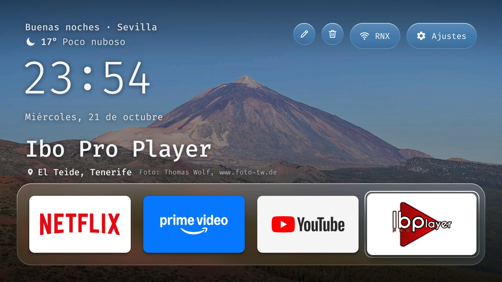
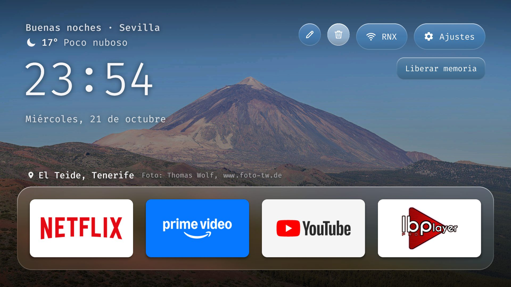
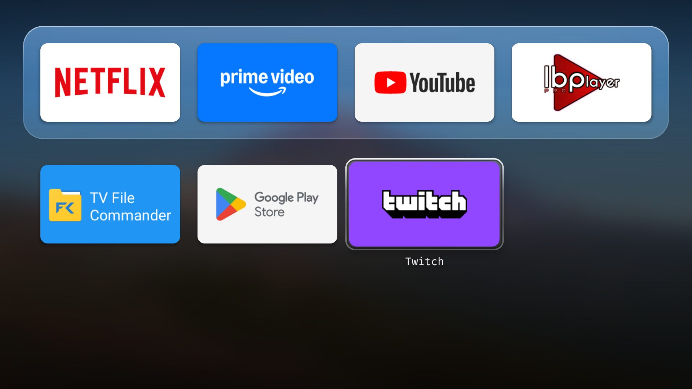
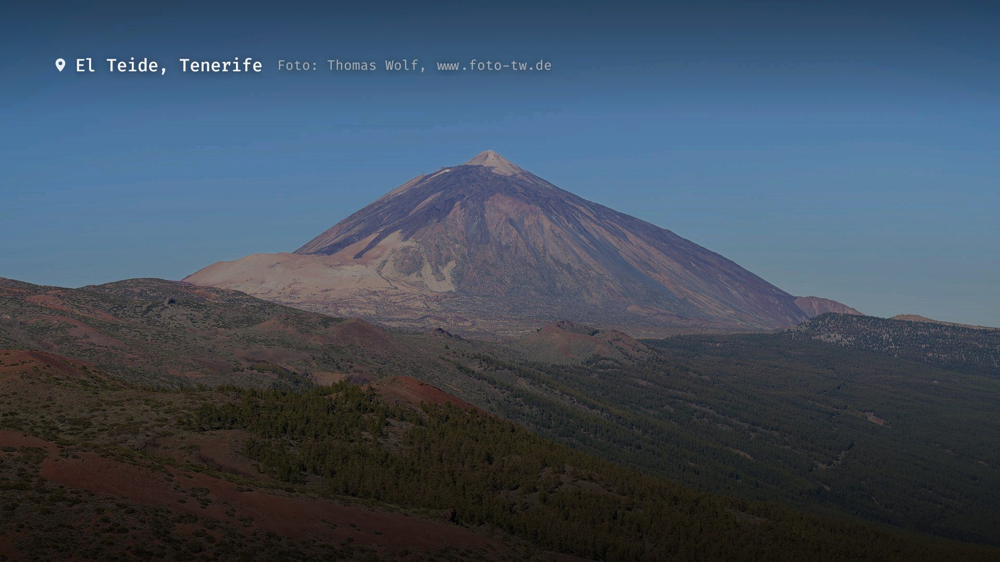
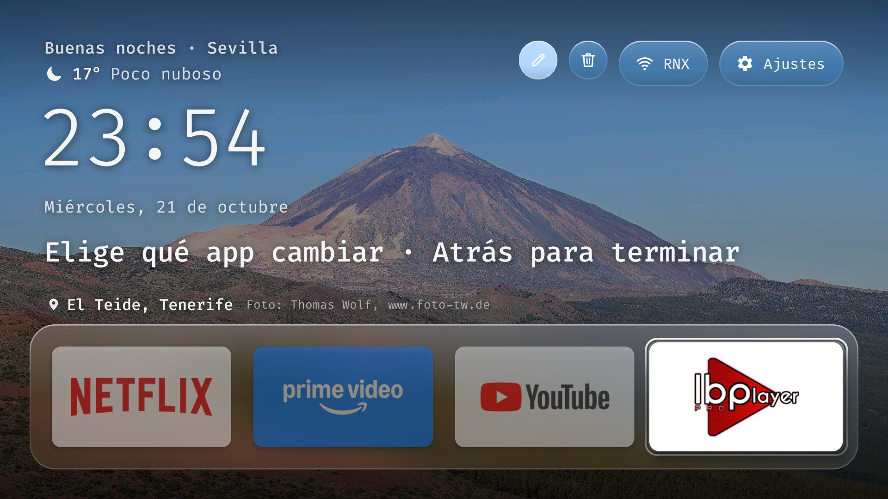
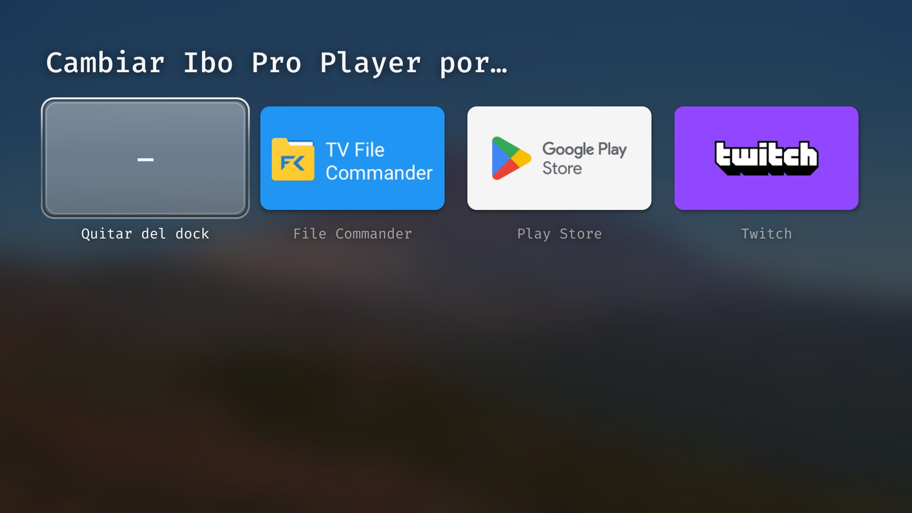

# 📺 LiquidTVOS

       

> **Your Android TV box, debloated and dressed as an Apple TV.** A tiny home screen with **Liquid Glass** surfaces over rotating photos of Spain, plus a toolkit that strips the manufacturer's telemetry and ads — all over Wi-Fi, from your computer, nothing rooted. 🍏✨

Stock Android TV launchers are slow, crammed with "recommended" rows you never asked for, and the box ships with analytics and ad-tracking services running in the background. LiquidTVOS replaces the home screen with a clean, fast one that runs happily on a 2 GB box, and its scripts disable the junk with `pm disable-user` — which is fully reversible. ⚡



| 🧭 Top bar | 🔲 App grid | 🌙 Screensaver |
|---|---|---|
|  |  |  |
| ✏️ **Editing the dock** | 🔁 **Picking an app** | |
|  |  | |

---

## ✨ What you get

### 🪟 The home screen
- 💧 **Liquid Glass** — the dock, the pills and the focus are glass that shows the *real* photo behind them, blurred. The blur is computed once when the APK is built, so the box never blurs anything at runtime.
- 🫧 **One liquid focus** that stretches towards where it is going and springs back when it lands, instead of a border on every tile.
- 🇪🇸 **35 photos of Spain** (Alhambra, Sagrada Família, Teide, Cuenca, Ronda, Cabo de Gata…) that change every 3 minutes and every time you come back home, with the place and the author shown above the dock.
- 🌤️ **Weather** next to the greeting — temperature and sky for your town, from Open-Meteo.
- 🎛️ **Top bar**: ✏️ edit the dock · 🗑️ free memory · 📶 Wi-Fi (shows the network name) · ⚙️ Settings. The focused one says what it does.
- 🔲 **App grid** under the dock, on a blurred version of the photo; every app you install shows up on its own.
- 🌙 **Screensaver** — after a minute without touching the remote only the photo and its place stay on screen.
- 🧭 **Deterministic remote**: Up/Down move exactly one row, the ends of a row stop, and the last tile of every row is remembered.

### 🧹 The toolkit
| Script | What it does |
|--------|--------------|
| `tools/setup.py` | Downloads **adb** and the **Android SDK** into the repo (Windows, macOS, Linux) |
| `tools/backup.py` | Saves the TV's package lists, settings and props **before you change anything** |
| `tools/debloat.py` | Disables packages one by one, checks each one really got disabled, and logs it |
| `tools/restore.py` | Re-enables everything the debloat disabled, and gives the stock launcher back |
| `tools/build_launcher.py` | Builds the launcher APK **without Gradle** and installs it as the default Home |
| `tools/tv.py` | ADB helper: run a command, press remote keys, take a screenshot |
| `tools/adb-closed.py` | Proves network ADB is closed when you are done |
| `tools/fetch_photos.py` · `tools/prepare_photos.py` | Find, download and prepare background photos from Wikimedia Commons |

---

## 🧰 Tech stack

| Area | Technology |
|------|------------|
| Launcher | Java · plain Android framework (no AndroidX) · minSdk 26 / targetSdk 35 |
| Glass | Custom `Drawable` sampling a build-time blurred copy of the photo — no `RenderEffect`, no runtime blur |
| Build | `aapt2` + `javac` + `d8` + `zipalign` + `apksigner`, driven by Python — no Gradle |
| Remote apps button | `AccessibilityService` with key filtering (the system keeps `KEYCODE_ALL_APPS` for itself) |
| Weather | [Open-Meteo](https://open-meteo.com) forecast + geocoding (no API key) |
| Photos | Wikimedia Commons, cropped to 1920×1080 with Pillow |
| Font | [Fira Code](https://github.com/tonsky/FiraCode), subset to Latin with fontTools |
| Device control | ADB over Wi-Fi (port 5555) |
| CI/CD | GitHub Actions — automatic version, tag, release **and APK** on every push |

---

## ✅ Will it work on my TV?

| Device | Works? |
|--------|--------|
| 📦 Android TV / Google TV boxes and TVs — Xiaomi Mi Box, TCL, Hisense, Sony, Philips, Nvidia Shield, OnePlus, Realme… | ✅ Yes, Android **8.0 or newer** |
| 📺 Samsung (Tizen), LG (webOS) | ❌ No — not Android |
| 🔥 Amazon Fire TV | ❌ No — Fire OS refuses `pm disable-user` and third-party launchers |
| 🇨🇳 China-market sets that refuse every sideloaded APK (`INSTALL_FAILED_VERIFICATION_FAILURE`) | ⚠️ Debloat only, no launcher |

Check your TV's Android version: **Settings → Device Preferences → About → Version**. It was built and tested on a **Xiaomi Mi Box 4** (Android 9, 2 GB RAM); `profiles/mibox4.txt` is its debloat list.

---

## 🚀 Quick start

```bash
git clone https://github.com/Ren0X1/LiquidTVOS.git
cd LiquidTVOS
python tools/setup.py                 # adb + Android SDK into the repo
cp local.example.json local.json      # then put your TV's IP in it
python tools/tv.py getprop ro.build.version.sdk   # first connection: accept the prompt on the TV
python tools/backup.py                # save the TV's current state
python tools/build_launcher.py        # build, install, set as Home
```

Press **Home** on the remote — you are in LiquidTVOS. 🎉 The steps below explain each one.

---

## 📖 Full guide

### 1️⃣ Turn on developer mode on the TV
1. **Settings → Device Preferences → About** → press OK on **Build** seven times until it says you are a developer.
2. Back to **Device Preferences → Developer options** → turn on **USB debugging** (and **Network debugging** / **ADB debugging** if your TV shows it).
3. Write down the TV's IP: **Settings → Network & Internet → your Wi-Fi**.

> 💡 On some Google TV sets only **Wireless debugging** exists. Pair once from your computer with `platform-tools/adb pair <ip>:<pairing port>` (the code is under *Wireless debugging → Pair device with pairing code*), then `adb connect <ip>:<port>` and `adb tcpip 5555`.

> ⚠️ Some boxes cut the power of their USB port while USB debugging is on. A USB drive or speaker plugged into the box goes dead until you switch debugging off again.

### 2️⃣ Install the tools on your computer
You need **Python 3.9+** and a **JDK 17 or newer** ([Temurin](https://adoptium.net) is fine).

| OS | Commands |
|----|----------|
| 🪟 Windows | `winget install Python.Python.3.13 EclipseAdoptium.Temurin.21.JDK` |
| 🍎 macOS | `brew install python openjdk@21` |
| 🐧 Linux (Debian/Ubuntu) | `sudo apt install python3 python3-pip openjdk-21-jdk-headless` |

Then, from the repo folder:

```bash
pip install pillow fonttools          # only needed to change photos or fonts
python tools/setup.py
```

`setup.py` downloads Google's **platform-tools** (adb) and the **Android command-line tools** with `platforms;android-35` and `build-tools;35.0.0` into the repo, and accepts the SDK licences. If you already have an SDK, set `ANDROID_HOME` and it uses that one.

### 3️⃣ Tell the tools where your TV is
```bash
cp local.example.json local.json
```
```json
{
  "tv_host": "192.168.1.50",
  "tv_port": 5555,
  "weather_city": "Sevilla, ES"
}
```
`local.json` is in `.gitignore`: your IP and your town never reach git. `weather_city` takes a town with an optional two-letter country code; leave it empty to guess from your internet connection (which may land on your ISP's city).

Now connect once:
```bash
python tools/tv.py getprop ro.build.version.sdk
```
👉 The TV shows **"Allow USB debugging?"** — tick **Always allow from this computer** and accept. The command prints a number: **26 or higher** means the launcher will install.

### 4️⃣ Back up first
```bash
python tools/backup.py
```
Writes `backup/<date>/` with every package list, all settings, `getprop`, the display size/density, the apps that answer Home and a screenshot of your stock home screen.

### 5️⃣ Install the launcher
```bash
python tools/build_launcher.py
```
It builds `launcher/build/liquidtvos.apk`, installs it with `pm install` (no on-screen prompt to hang on), grants the location permission the Wi-Fi pill needs to show the network name, turns on the remote-button service, and makes it the default Home.

> 📦 Rather not build? Every [release](https://github.com/Ren0X1/LiquidTVOS/releases) has a ready APK: `platform-tools/adb install -r LiquidTVOS-vX.apk`. It uses the default settings (weather guessed from your connection).

Check it really owns Home:
```bash
python tools/tv.py "dumpsys activity activities | grep mResumedActivity"
```
If the stock launcher still answers the Home button, disable it in step 6 — on many boxes `set-home-activity` says *Success* and changes nothing while the stock launcher is enabled.

### 6️⃣ Debloat (optional, reversible)
Open the profile for your device (or copy `profiles/mibox4.txt` and adapt it), **comment out what you use**, then:
```bash
python tools/debloat.py -f profiles/mibox4.txt
```
- Packages are disabled for user 0 with `pm disable-user` — **never uninstalled**, so a factory reset or `restore.py` brings them back.
- One package per call, and each one is checked against `pm list packages -d` instead of trusting the exit code.
- Everything disabled is logged in `debloat/disabled.txt`, which `restore.py` reads.
- **Never disable** Play Store, Play Services, the keyboard, Bluetooth, the remote pairing service, Settings, or the TV/input apps of a real TV. When a manufacturer package name says nothing, look at it first with `python tools/tv.py dumpsys package <name>` — **don't launch** anything named *factory*, *fac menu* or *AT*.
- Disable the **stock launcher last**, after LiquidTVOS works.

Reboot once and check nothing came back:
```bash
python tools/tv.py reboot
python tools/tv.py pm list packages -d
```

### 7️⃣ Make it yours
| What | How |
|------|-----|
| 📌 **Dock apps** | On the TV: ✏️ pencil → pick a slot → pick an app, or **Remove from dock**. Saved on the box. Default order: `dock_packages` in `launcher/res/values/config.xml` |
| 🙈 **Hide apps** from the grid | Add the package to `hidden_packages` in `config.xml`, rebuild |
| ⏱️ **Photo interval** | `photo_minutes` in `config.xml` (default 3), rebuild |
| 🌤️ **Weather town** | `weather_city` in `local.json`, rebuild |
| 🖼️ **Your own photos** | See below |
| 🔤 **Language** | The UI text is Spanish; translate `launcher/res/values/strings.xml` |

**Changing the photos** — edit `photos/raw/chosen.json` (place, city, author, licence and the image URL), then:
```bash
python tools/fetch_photos.py download     # into photos/raw/
python tools/prepare_photos.py            # 1920×1080 + blurred copy + index.json
python tools/build_launcher.py
```
`tools/fetch_photos.py candidates` searches Commons (Featured pictures first, then Quality images) for the places listed in the script, if you want ideas.

### 8️⃣ Extras
**🛡️ Ad-blocking DNS** (Android 9+) — blocks ads and trackers in apps and websites, **not YouTube ads**:
```bash
python tools/tv.py settings put global private_dns_specifier dns.adguard-dns.com
python tools/tv.py settings put global private_dns_mode hostname
```
Undo: `python tools/tv.py settings put global private_dns_mode opportunistic`

**🔊 Quiet dialogue in Netflix / Prime Video** — those apps send 5.1 audio, and many boxes downmix it to stereo with the voices far below the effects. Let the TV do the downmix instead:
```bash
python tools/tv.py settings put global encoded_surround_output_enabled_formats 5,6
python tools/tv.py settings put global encoded_surround_output 3
```
Then turn on your TV's dialogue / voice mode. If Netflix goes silent, your TV doesn't take Dolby Digital Plus: `python tools/tv.py settings put global encoded_surround_output 1`.

### 9️⃣ Close ADB when you are done 🔒
Port 5555 is plain text; while it is open, anything on your network can get a shell on the TV.
1. **Developer options → Revoke USB debugging authorisations**, then turn **USB debugging** off.
2. Reboot the TV.
3. Check:
   ```bash
   python tools/adb-closed.py
   ```
   Only **`CLOSED (connection refused)`** proves it. A timeout just means the TV did not answer.

Turn debugging back on whenever you want to change something.

---

## 🎮 Using it

| Remote | On the home screen |
|--------|--------------------|
| ⬅️➡️ | Move along a row (stops at the ends) |
| ⬆️ | Dock → top bar · grid → the row above |
| ⬇️ | Top bar → dock → app grid, one row at a time |
| 🆗 | Open the app / press the button |
| 🆗 *hold 1 s* | App → its info screen (uninstall, force stop) · 🗑️ → Storage (clear cached data) |
| 🔲 **Apps button** | Open the app grid from anywhere — press again to go back to the dock |
| ↩️ **Back** | Back to the dock / leave the dock editor |
| 🏠 **Home** | Always back here |

---

## 📁 Repository layout

```
LiquidTVOS/
├── launcher/                    # 📺 the home screen app
│   ├── AndroidManifest.xml
│   ├── src/com/alex/tvhome/
│   │   ├── HomeActivity.java    #    layout, focus, photos, dock editor, screensaver
│   │   ├── GlassDrawable.java   #    the liquid glass surface
│   │   ├── Weather.java         #    Open-Meteo
│   │   └── KeyService.java      #    catches the remote's apps button
│   ├── res/values/config.xml    #    dock, hidden apps, photo interval
│   └── assets/                  #    photos (+ blurred copies, index.json) and Fira Code
├── tools/                       # 🧰 Python scripts (setup, backup, debloat, restore, build…)
├── profiles/mibox4.txt          # 🧹 debloat list for the Xiaomi Mi Box 4
├── photos/raw/chosen.json       # 🇪🇸 photo sources, authors and licences
├── docs/                        # 📸 screenshots and photo credits
├── local.example.json           # ⚙️ copy to local.json (TV IP, weather town)
└── .github/workflows/release.yml
```

---

## 🧯 Troubleshooting

- **`No TV address`** — create `local.json` from `local.example.json`, or `TV_HOST=192.168.1.50 python tools/tv.py …`.
- **`unauthorized`** — look at the TV: accept the *Allow USB debugging?* prompt, ticking *Always allow*.
- **Port 5555 closed** — the TV may only offer *Wireless debugging*; see the tip in step 1. Android turns Wireless debugging off whenever Wi-Fi drops.
- **`INSTALL_FAILED_OLDER_SDK`** — the TV runs Android 7 or older; the launcher needs 8.0+. The debloat still works.
- **`INSTALL_FAILED_VERIFICATION_FAILURE`** on every APK — the firmware refuses sideloading. Debloat only.
- **`INSTALL_FAILED_UPDATE_INCOMPATIBLE`** — the installed copy was signed with another key (a release APK vs. your own build). `python tools/tv.py pm uninstall com.alex.tvhome` and install again.
- **Home still opens the stock launcher** — disable it (`com.google.android.tvlauncher` on Android TV) after LiquidTVOS is installed. On Google TV the setup wizard (`com.google.android.tungsten.setupwraith`) can also claim Home: check `dumpsys wifi | grep -o 'cname=[^ ]*'` first, because disabling it deletes a Wi-Fi network saved during first setup.
- **Empty app grid** — Android 11+ hides apps without `<queries>`; the manifest has it, so rebuild from this repo rather than an old APK.
- **Wi-Fi pill says "Wi-Fi" instead of the network name** — the location permission was not granted: `python tools/tv.py pm grant com.alex.tvhome android.permission.ACCESS_FINE_LOCATION`.
- **The apps button does nothing** — the accessibility service is off: **Settings → Device Preferences → Accessibility → Botón de apps del mando**, or run `build_launcher.py` again.
- **Screen looks zoomed after a reboot** — read `wm size`, `wm density` and `settings get secure display_density_forced` before touching the launcher; a leftover override is not a launcher bug.
- **Screenshots of Netflix, Live TV or HDMI are empty** — that's DRM, not a broken box.

---

## 🧹 Undoing everything

```bash
python tools/restore.py        # re-enables every disabled package, stock launcher back as Home, DNS off
python tools/tv.py pm uninstall com.alex.tvhome
python tools/tv.py reboot
```

Without a computer: **Settings → Apps → See all apps → Show system apps → the app → Enable**.

---

## 📸 Credits

Background photos: Wikimedia Commons contributors, under the licences listed in **[docs/PHOTO_CREDITS.md](docs/PHOTO_CREDITS.md)**. Weather: [Open-Meteo](https://open-meteo.com). Font: Fira Code (SIL OFL 1.1).

---

> ⚠️ Disabling system packages can stop features you rely on (voice search, casting, firmware updates). Everything here is reversible, but read the profile before you run it.
>
> 🛠️ **LiquidTVOS** by [Ren0X1](https://github.com/Ren0X1).
